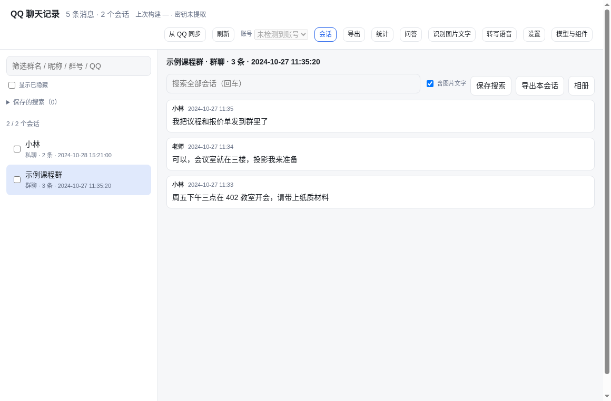

# dsh-qqnt-chat-export

把 **Windows / Linux 上的 NTQQ（QQ NT / 9.9.x）聊天记录**读出来、搜出来、导出来 —— 一个 DeepSeek Harness 插件包：十五个模型工具 + 一个本地网页界面，支持群聊和私聊，可导出 6 种格式，还能识别截图里的文字、转写语音，并按问题检索聊天记录、给出可点回的引用。

Read, search, and export NTQQ chat history from a DeepSeek Harness session or from a local web page, on Windows or Linux.



> 截图使用虚构数据渲染，不含任何真实聊天内容。

## 功能

- **十五个模型工具**：体检与排障（`qqnt_doctor`）、建索引（`qqnt_index`）、统计（`qqnt_stats`）、后台任务（`qqnt_jobs`）、取图（`qqnt_media`）、提取密钥、群列表、会话列表、跨会话搜索、单群 / 单会话 / 批量导出，以及问答检索（`qqnt_ask`）与主题回看（`qqnt_recall`）；
- **本地网页界面**（`http://127.0.0.1:46728`）：全部会话列表、组合查询与高亮、图片预览 / 相册、统计、批量导出、导出预设；
- **索引与搜索**：首次同步建旁路明文索引 `index.sqlite`，之后查询与导出只读它；关键词走 FTS5 trigram，中文子串也是索引查找；支持多账号索引缓存；
- **看得懂内容**：截图里的文字可以 OCR 成可搜索文本，语音消息可以转写成文字，两者都进入搜索与问答的文本池；模型文件按需下载、在「模型与组件」里逐个删除，OCR/转写/向量需要的 Python 组件也在那里一键安装；
- **问得清问题**：把会话切成带上下文的片段并做本地嵌入，`qqnt_ask` 返回「最可能回答这个问题的几段对话 + 引用」，答案由宿主模型（或你自己）来写，引用永远能点回原文；不装嵌入模型也能用关键词检索；
- **分享与保护**：昵称 / QQ 脱敏、媒体打包、按天分文件、AES-256 密码 ZIP；
- **DSH 侧边栏面板**：左侧栏多一个「QQ 聊天记录」图标，主区直接打开同一个页面，不用切浏览器标签。
- **界面**：会话列表与阅读、搜索、问答、导出、统计、模型与组件、设置、任务面板全在同一个单页应用里（`/` 与 `/app/` 是同一页，无构建步骤）。


> 同样用虚构数据渲染。

详细功能、面板行为与每个导出选项见 [docs/features.md](docs/features.md)。

## 安装

`dsh plugin` 只是把参数转给 profile 目录里的 pnpm，所以直接把 GitHub 仓库当依赖装：

```bash
dsh plugin --profile web add github:ariyflow/dsh-qqnt-chat-export
```

`web` 换成你要装进去的 profile 名。装好后插件行 `qqnt-chat-export` 自动启用，八个工具立刻可见，网页在 `http://127.0.0.1:46728/`。

也可以先克隆到本地，再按目录装（改源码调试时更顺手）：

```bash
git clone https://github.com/ariyflow/dsh-qqnt-chat-export.git
dsh plugin --profile web add /path/to/dsh-qqnt-chat-export
```

卸载：

```bash
dsh plugin --profile web remove dsh-qqnt-chat-export
```

> 插件行的 id 固定为 `qqnt-chat-export`。如果之前装过旧的 `@local/qqnt-chat-export` 本地包，先把它 remove 掉，否则两个包会抢同一个行 id。装完重启 DSH，`GET /api/qqnt/panel` 返回 200 就说明宿主半边已加载。

## 快速开始

**第一次**（QQ 保持登录，别关）：

1. 打开网页（默认 `http://127.0.0.1:46728/`），进「设置」看运行环境；
2. 缺依赖时点「默认源安装」或「清华镜像安装」，等独立虚拟环境装好（不碰系统 Python）；
3. 点「提取密钥」—— **首次约 1~3 分钟，请耐心等待**，期间保持 QQ 登录；也可以在对话里运行 `qqnt_extract_key`；
4. 回到顶栏点「从 QQ 同步」，约 1 分钟建好索引；
5. 之后随便查、随便导。

**以后**：默认每 60 分钟自动同步一次（设置页可关或改间隔），也可以随时点「从 QQ 同步」。同步会连 `-wal`/`-shm` 一起复制并回放，所以 QQ 一直开着也能拿到最新几条；没有新消息时不重建索引，源库出现删除、回溯或换账号时按数量校验退回全量重建。

环境安装、设置项与清理的细节见 [docs/setup.md](docs/setup.md)。

## 工具

| 工具 | 作用 |
|---|---|
| `qqnt_status` | 体检：QQ 进程、各账号数据库体积、密钥缓存、Python / SQLCipher / 内存读取权限 |
| `qqnt_doctor` | 一条命令说清「为什么用不了」：版本、解释器与依赖、密钥、ptrace、索引、派生库 + 下一步该做什么；`deep: true` 再查组件与模型 |
| `qqnt_index` | 查索引状态或直接建立/刷新索引（`action: "build"`）。构建在后台跑，超时只回进度、不杀进程 |
| `qqnt_extract_key` | 从**已登录**的 QQ 进程内存里取出数据库密钥并缓存 |
| `qqnt_list_groups` | 群列表：消息数、时间范围、群名 |
| `qqnt_export_group` | 导出单个群为 txt / sqlite / csv |
| `qqnt_list_chats` | 索引里的**全部会话**（群聊 + 私聊）：类型、id、名称、消息数、最后时间；`query` 可按名字/别名/群号/QQ 过滤 |
| `qqnt_search` | 跨会话关键词搜索（可限定会话、发送者、日期；`senderRegex` 把发送者当正则） |
| `qqnt_stats` | 聚合统计：总量、会话数、发言人数、月度、Top 发言人 / 会话、24 小时分布；与搜索同名的过滤条件 |
| `qqnt_jobs` | 看 / 起 / 取消 / 重试后台任务（图片识别、语音转写、分块嵌入、下载模型、安装组件）；和网页共用一条队列，两边看到的是同一批任务，缺组件/模型时先说缺什么而不是排一个注定失败的任务 |
| `qqnt_media` | 一个会话的图片：`list` 分页列表、`get` 给出原图路径（不复制）、`export` 按时间范围拷到下载目录；只算本机已经下载过的图片，不会联网补 |
| `qqnt_export_chat` | 导出任意会话为 txt / csv / json / md / html / sqlite；`chat` 可直接给名字（歧义时拒绝并返回候选），`dryRun` 先预演，`keyword`/`sender`/`since`/`until` 只导一部分 |
| `qqnt_export_batch` | 一次导出最多 200 个会话到一个 ZIP（每会话一份文件 + `manifest.json`）；`chatNames` 可直接给名字列表，`keyword`/`sender`/`since`/`until` 对每个会话同时生效 |

`qqnt_list_chats` / `qqnt_stats` / `qqnt_search` / 两个导出工具读的是旁路索引，因此能覆盖私聊和跨会话搜索；索引不在时不用去网页点「从 QQ 同步」，直接调 `qqnt_index`（`action: "build"`）就行，它会把构建放在后台并把进度报回来。两份导出预设由工具和网页共用（`workDir/presets.json`），预设名字写错时会列出可用的那几个。

## 要求

- Windows 10/11 或 Linux（x86_64 / arm64）；不支持 macOS；
- 已安装并**登录**的 NTQQ（QQ 9.9.x / NT 架构）；
- 64 位 Python 3，`sqlcipher3` 装在本插件自己的虚拟环境里即可（密码 ZIP 另需 `pyzipper`）；推荐装 [uv](https://docs.astral.sh/uv/)，装了就优先用它创建环境；
- Linux 取密钥要能读 `qq` 进程内存：`sudo sysctl -w kernel.yama.ptrace_scope=0` 临时放开，导完改回 `1`。被拒绝时 `qqnt_status` 会显示状态，`qqnt_extract_key` 会打印修复命令。

数据目录、手动创建环境、安装引擎与 ptrace 细节见 [docs/setup.md](docs/setup.md)。

## 隐私与安全

- `workDir` 里是**明文**：`key.txt`（明文密钥）、`nt_msg.db`（约 1 GB 解密副本）、`index.sqlite`（全部消息的明文副本）。用完建议整个删掉；把 `key.txt` 给别人等于把整个 QQ 数据库给别人；
- 对 QQ 原始数据**只读**，不结束 QQ 进程；媒体默认不复制，勾选「含媒体」才把本机已下载的文件复制进 ZIP；
- 网页只绑 `127.0.0.1`，拒绝非本机 `Host` 与跨站 `POST`；侧边栏面板路由也只接受本机回环；
- 密码 ZIP 的密码只经环境变量传给子进程，不出现在命令行、任务列表和日志里；ZIP 内的**文件名**仍是明文；
- 脱敏只作用于发送者、QQ 号、会话名与清单，**不改写正文**；诊断包不含消息、昵称、群名、会话 id 和 QQ 号明文。

完整清单（诊断包字段、导出转义、任务列表内容、媒体与 ptrace 的影响）见 [docs/security.md](docs/security.md)。

## 已知限制

- 只支持本机已登录的 QQ；WSL 里读不到 Windows 侧 QQ 的内存，需要在 WSL 内装 Linux 版 QQ；
- 增量同步不感知「消息被编辑」；QQ 侧删除或回溯会触发一次全量重建；
- 索引占空间：32 万条时 `index.sqlite` 约 93 MB（含 FTS），账号索引缓存默认再留 2 份；
- 媒体只导出本机已下载的文件，QQ 清理过的找不回来；语音导出 `.amr` 原文件，不转写；表情不导出；
- 侧边栏面板是 iframe：切走再切回会重新加载，页面状态不保留；DSH 用 HTTPS 打开时浏览器会拦混合内容，面板给提示而不是白屏。

其余边界（多账号、FTS 回退、`in:` 匹配、端口设为 0、升级迁移等）见 [docs/limitations.md](docs/limitations.md)。

## 文档

- [docs/features.md](docs/features.md) — 网页界面、侧边栏面板、导出选项
- [docs/setup.md](docs/setup.md) — 安装环境、设置与清理、Linux ptrace
- [docs/configuration.md](docs/configuration.md) — `cordis.patch.yml` 字段与设置项
- [docs/security.md](docs/security.md) — 隐私与安全、诊断包字段
- [docs/limitations.md](docs/limitations.md) — 已知限制与注意事项
- [docs/how-it-works.md](docs/how-it-works.md) — 密钥、SQLCipher、Protobuf 与索引
- [docs/development.md](docs/development.md) — 目录结构、测试、`file:` / `link:` 安装方式
- [docs/wal-notes.md](docs/wal-notes.md) · [docs/media-notes.md](docs/media-notes.md) — WAL 与媒体的实测笔记
- [docs/agent-tools-plan.md](docs/agent-tools-plan.md) — 给 Agent 调用的工具扩展计划（未实现）

## 许可

MIT，见 [LICENSE](LICENSE)。

本项目仅供学习参考，未获腾讯授权。对于任何用途所造成的一切后果，本人不承担任何责任。

## 特别感谢

- https://github.com/JackHanXyz/qq-nt-decrypt
- https://github.com/QQBackup/qq-win-db-key
- https://github.com/QQBackup/QQDecrypt
