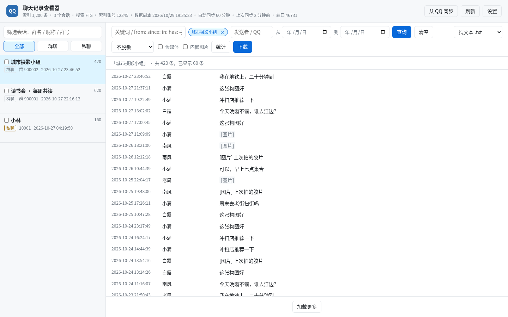

# dsh-qqnt-chat-export

把 **Windows / Linux 上的 NTQQ（QQ NT / 9.9.x）聊天记录**读出来、搜出来、导出来 —— 一个 DeepSeek Harness 插件包：四个模型工具 + 一个本地网页界面，支持群聊和私聊，可导出 6 种格式。

Read, search, and export NTQQ chat history from a DeepSeek Harness session or from a local web page, on Windows or Linux.



> 截图使用虚构数据渲染，不含任何真实聊天内容。

## 它能做什么

**模型工具（在 DSH 会话里直接调用）**

| 工具 | 作用 |
|---|---|
| `qqnt_status` | QQ 进程、各账号数据库体积、密钥缓存、Python/SQLCipher/内存读取权限体检 |
| `qqnt_extract_key` | 从**已登录**的 QQ 进程内存里取出数据库密钥并缓存 |
| `qqnt_list_groups` | 群列表：消息数、时间范围、群名 |
| `qqnt_export_group` | 导出单个群为 txt / sqlite / csv |
| `qqnt_list_chats` | 索引里的**全部会话**（群聊 + 私聊）：类型、id、名称、消息数、最后时间 |
| `qqnt_search` | 跨会话关键词搜索（可限定会话、发送者、日期），返回会话/发送者/时间 |
| `qqnt_export_chat` | 按 `chatKind` + `chatId` 导出任意会话为 txt / csv / json / md / html / sqlite；可选 `redact`（脱敏）、`media`（含媒体，ZIP）、`split=day`（按天分文件，ZIP）、`embed`（图片内嵌的单文件 HTML） |

后三个工具读的是网页建立的旁路索引，因此能覆盖私聊和跨会话搜索；没有索引时会提示先去网页点「从 QQ 同步」。

**网页界面（`http://127.0.0.1:46728`）**

- 左侧列出**全部会话**（群聊 + 私聊），带消息数、最后活动时间，可按群名/昵称/群号/QQ 号筛选；
- 关键词、发送者、起止日期组合查询，跨会话搜索，命中处高亮；关键词框还支持 `from:昵称/QQ`、`since:YYYY-MM-DD`、`until:...`、`in:群名/群号`、`has:image/file/voice/video`、`-排除词`；
- 跨会话搜索的每条结果都标出**所在会话**，点「在会话中查看」直接跳到该消息前 20 / 后 19 条上下文并高亮；
- **统计**：点「统计」按当前筛选条件（会话/关键词/日期）显示每月消息量、24 小时分布、发言人 Top 10、活跃会话 Top 10，并可**导出 CSV**；全部在本机 SQL 里算，不上传、不调用模型；
- 关键词框有**搜索历史**（最近 20 条，存在浏览器 localStorage）；自动同步失败会在状态行和 toast 里提示，不会静默停在旧时间；
- 会话列表悬停有「在本会话中搜索」，查询范围以蓝色徽标显示（`×` 回到全部会话）；
- 把**当前查询结果**导出为 `.txt` / `.csv` / `.json` / `.md` / `.html` / `.sqlite`：大导出进入后台任务队列（最多同时 3 个，30 分钟上限），右下角任务面板显示「导出中 / 完成 / 失败 / 已取消」，可随时取消，不再受 180 秒请求超时限制；
- **批量导出**：在会话列表勾选多个群聊/私聊，一次打成 ZIP（每个会话一份文件 + `manifest.json`），最多 200 个会话；
- **脱敏分享**：导出时可选「昵称打码 / QQ 号打码 / 全部」，发送者变成 `成员1…`、会话名变成 `群聊1/私聊1`，QQ 号和群号清空；正文保持原样（改动会破坏对话）；
- **含媒体**：可选把本机已下载的图片、文件、语音、视频一起打包（ZIP 布局 `media/<会话>/…`）；缺失的媒体只记录不报错，单文件 100 MB、单次 1 GB 上限；**内嵌图片**把图片 base64 放进单个 HTML，方便直接分享（单会话、10 MB/图、200 MB/次）；
- **按天分文件**：勾选后每个会话按日期拆成多个文件再打包成 ZIP，`manifest.json` 列出每天的文件和条数；可以和脱敏、媒体一起用；
- **导出字段**：CSV 可选列（全部 / 时间+发送者+内容 / 时间+发送者+类型+内容）；Markdown 可选在开头加 YAML 元信息（会话、账号、导出时间），默认关闭；，导出包会用 AES-256 加密（需要 `pyzipper`，一键安装会装）；密码只经子进程环境变量传递，不会出现在命令行、任务列表或日志里。ZIP 内的文件名不加密，内容加密；打开请用 7-Zip / WinRAR / Bandizip / macOS 归档工具，**Windows 资源管理器自带的解压不支持 AES**；
- 「从 QQ 同步」复制最新数据库后**增量追新消息**；消息总数对不上（删除/回溯/换账号）时自动全量重建；
- **启动提示**：网页打开后显示一次启动横幅，告知默认访问地址，并检查 Python / sqlcipher3 / pyzipper / 密钥；缺依赖时可一键创建独立虚拟环境并安装（默认源或清华镜像）；
- **密钥提取**：启动横幅和设置页都有「提取密钥」按钮，网页内显示扫描进度、日志和结果；已配置时可重新提取；点击前后都会提示查找密钥耗时较长（通常 1~3 分钟），请耐心等待；
- **设置**：端口、工作目录 / 索引位置、环境安装方式（自动 / uv / pip）、Python 解释器、QQ 数据根目录、QQ 号、保留账号索引数、搜索索引方式，以及 Python/uv/sqlcipher3/pyzipper 体检；
- **多账号索引缓存**：切换 QQ 账号时把上一个账号的索引留在 `workDir` 里（默认保留 2 个），切回时直接增量更新，不再整库重建；
- **存储与清理**：分类列出插件生成的明文文件及大小（含各账号的缓存索引），二次确认后删除，不碰 QQ 原始数据。

统计面板按当前筛选（会话 / 关键词 / 日期）计算，全部在本机完成：


## 要求

- Windows 10/11 或 Linux（x86_64 / arm64）
- 已安装并**登录**的 NTQQ（QQ 9.9.x / NT 架构）
  - Windows 数据目录：`%USERPROFILE%\Documents\Tencent Files\<QQ号>\nt_qq\`
  - Linux 数据目录：`~/.config/QQ/nt_qq_<hash>\`
    （Flatpak 为 `~/.var/app/com.qq.QQ/config/QQ/`，Snap 为 `~/snap/qq/current/.config/QQ/`）
- 64 位 Python 3；`sqlcipher3` **装在这个插件自己的虚拟环境里** 即可；密码 ZIP 另外需要同一环境里的 `pyzipper`（一键安装会一起装）。网页启动横幅提供一键配置，不需要也不建议装进系统 Python。
- 可选：[uv](https://docs.astral.sh/uv/)（推荐）。装了就自动优先用它——它自带 Python 下载，能绕开系统 Python 版本不对或缺少 `python3-venv` 的问题；没装则退回 `venv + pip`。插件**不会**替你下载 uv。

> Windows 与 Linux 共用同一套导出/查询脚本：Windows 走 `ctypes` + `ReadProcessMemory`，
> Linux 走 `/proc/<pid>/mem`；两边的默认数据目录、默认 Python 解释器和进程名分别适配，
> Windows 原有的行为和配置默认值保持不变。

**推荐**：打开网页，用启动横幅或「设置」里的「默认源安装」/「清华镜像安装」。它会在
`~/.local/share/dsh-qqnt-chat-export/venv`（Windows 为 `%LOCALAPPDATA%\dsh-qqnt-chat-export\venv`）
创建独立虚拟环境并安装 `sqlcipher3-wheels`（以及可选但推荐的 `pyzipper`，用于密码 ZIP），然后自动切换插件使用的解释器。

- **默认源**：直接使用默认 PyPI；
- **清华镜像**：使用 `https://pypi.tuna.tsinghua.edu.cn/simple`，适合国内网络。

安装引擎由「设置 → 环境安装方式」决定：

| 取值 | 行为 |
|---|---|
| `auto`（默认） | 装了就优先用 uv，没有或 uv 失败时自动退回 `venv + pip` |
| `uv` | 只用 uv；检测不到 uv 直接报错并给出安装地址 |
| `pip` | 只用系统 Python 的 `venv` + `pip` |

走 uv 时命令是 `uv venv --python 3.12 <venv>` + `uv pip install --python <venv>/bin/python [--index-url <镜像>] sqlcipher3-wheels pyzipper`。
Python 版本由 `pythonVersion` 决定（默认 `3.12`，uv 会自动下载托管解释器），
`python/` 目录里还提供了一份可手工复现的 `pyproject.toml` + `.python-version`。

手动创建时也只装进虚拟环境：

```powershell
# Windows（默认源）
python -m venv "$env:LOCALAPPDATA\dsh-qqnt-chat-export\venv"
& "$env:LOCALAPPDATA\dsh-qqnt-chat-export\venv\Scripts\python.exe" -m pip install sqlcipher3-wheels pyzipper
# 清华镜像：
# & "$env:LOCALAPPDATA\dsh-qqnt-chat-export\venv\Scripts\python.exe" -m pip install -i https://pypi.tuna.tsinghua.edu.cn/simple sqlcipher3-wheels pyzipper
# 然后把网页「设置」里的 Python 解释器填成上面的 Scripts\python.exe
```

```bash
# Linux（默认源）
python3 -m venv ~/.venvs/qqnt
~/.venvs/qqnt/bin/pip install sqlcipher3-wheels pyzipper
# 清华镜像：
# ~/.venvs/qqnt/bin/pip install -i https://pypi.tuna.tsinghua.edu.cn/simple sqlcipher3-wheels pyzipper
# 然后把网页「设置」里的 Python 解释器填成 ~/.venvs/qqnt/bin/python
```

不要用 `sudo pip` 或 `--break-system-packages` 把它装进系统 Python；Debian/Ubuntu 如果连
`python3 -m venv` 都失败，先 `sudo apt install python3-venv`。

### Linux 取密钥的权限（重要）

Linux 上数据库密钥同样只存在于 `qq` 主进程的内存里。读取 `/proc/<pid>/mem` 受内核
`kernel.yama.ptrace_scope` 限制：默认值 `1` 只允许读取自己子进程的内存，而 QQ 不是本工具的子进程，
因此会报「权限不足」。先确认再临时放开：

```bash
cat /proc/sys/kernel/yama/ptrace_scope     # 1 = 默认受限
sudo sysctl -w kernel.yama.ptrace_scope=0  # 临时放开，重启后恢复
```

要长期生效，可写入 `/etc/sysctl.d/99-qqnt.conf`：

```ini
kernel.yama.ptrace_scope = 0
```

注意：`0` 允许同一用户的任意进程互相读取内存，安全性低于默认值；导出完成后建议改回 `1`
（`sudo sysctl -w kernel.yama.ptrace_scope=1`）。也可以直接用 root 运行取密钥的命令，
但工作目录里的文件会归 root 所有。`qqnt_status` 会直接显示当前「内存读取」状态；
被拒绝时 `qqnt_extract_key` 也会打印同样的修复命令。

## 安装

在 DSH 会话里让 agent 安装，等价于：

```text
plugin_manager install_bundle → github:ariyflow/dsh-qqnt-chat-export
```

装好后插件行 `qqnt-chat-export` 会自动启用，四个工具立刻可见，网页在 `http://127.0.0.1:46728/`。

也可以克隆到本地后用绝对路径安装（`install_bundle` 接受目录）：

```bash
git clone https://github.com/ariyflow/dsh-qqnt-chat-export.git
# 然后用目录路径安装：plugin_manager install_bundle → <克隆下来的目录>
```

> **注意**：插件行的 id 是固定的 `qqnt-chat-export`。如果你已经装了旧的 `@local/qqnt-chat-export` 本地版本，先 `remove_bundle` 卸掉，否则两个包会抢同一个行 id。

## 使用

**第一次**（QQ 保持登录，别关）：

1. 打开网页（默认 `http://127.0.0.1:46728/`，改过端口则以实际为准）。启动横幅会显示默认访问地址，并检查 Python / sqlcipher3 / pyzipper / 密钥；
2. 环境缺失时点「默认源安装」或「清华镜像安装」，等待虚拟环境创建和依赖安装完成；也可以先 `qqnt_status` 看命令行体检结果；
3. 在网页点「提取密钥」 —— **首次约 1~3 分钟，耗时较长，请耐心等待**（期间保持 QQ 登录、不要关闭 QQ）；页面会显示扫描/校验进度和日志，成功后密钥缓存在工作目录；也可以在对话里运行 `qqnt_extract_key`；
4. 回到网页，点「建立索引」，约 1 分钟；
5. 之后随便查、随便导。

**以后**：默认每 60 分钟自动同步一次（设置页可关或改间隔），也可以随时点「从 QQ 同步」。同步会把 `nt_msg.db` 连同它的 `-wal`/`-shm` 一起复制到工作目录，用 SQLCipher 读写打开副本、让 SQLite 自己回放还没合并的 WAL 帧并 checkpoint，所以「QQ 一直开着、最近几条只在 WAL 里」也能同步到；回放失败会自动退回只复制主库，并在状态行标「WAL 待合并」。没有新消息时不重建索引。源库出现删除、回溯或换账号时会按数量校验退回全量重建。

## 启动提示与一键配置

插件启动网页服务后，页面打开时会显示一次启动横幅（按网页服务启动时间区分，关闭提示后同一次启动不再打扰）。同一个地址也会写进 DSH 的系统提示和启动日志，Agent 可以直接告诉你；

- **默认访问地址**：显示当前实际访问 URL，并提供复制按钮；模型侧也会拿到同一个 URL，可直接问 agent。
- **环境检查**：显示 Python 版本、`sqlcipher3` 是否可用、密码 ZIP 所需的 `pyzipper` 是否可用。缺 `sqlcipher3` 时提供两个按钮：
  - **默认源安装**：直接使用默认 PyPI；
  - **清华镜像安装**：使用 `https://pypi.tuna.tsinghua.edu.cn/simple`；
  - 两者都会在 `~/.local/share/dsh-qqnt-chat-export/venv`（Windows `%LOCALAPPDATA%\dsh-qqnt-chat-export\venv`）创建**独立虚拟环境**；
  - 优先用 uv（可下载托管 Python、安装通常几秒）；uv 不可用或失败时自动退回系统 Python 的 `venv + pip`；
  - 只在这个虚拟环境里执行 `uv pip install` / `pip install sqlcipher3-wheels pyzipper`（镜像模式加 `--index-url`），**不修改系统 Python**；
  - 完成后自动把设置里的 Python 解释器切过去并持久化；
  - 页面实时显示安装源、步骤、耗时和日志；已有可用虚拟环境时直接复用；一个源失败可以直接换另一个重试。
- **密钥检查**：环境就绪且未配置时，启动横幅和设置页「数据库密钥」卡片都会显示「提取密钥」按钮：
  - 点击后在后台运行 `qqnt_export.py key`，页面显示步骤、耗时和日志；开始前会提示查找密钥耗时较长（通常 1~3 分钟），请耐心等待；
  - 成功后自动隐藏按钮并标记已配置；已配置时设置页显示「重新提取密钥」；
  - 日志里的密钥会自动隐去；SQLCipher 逐候选项噪声折叠成计数；
  - 需要 QQ 已启动并登录；Linux 上如果 `kernel.yama.ptrace_scope` 受限，会直接提示并拒绝启动，先执行 `sudo sysctl -w kernel.yama.ptrace_scope=0`。

环境一键配置只负责 Python 依赖；密钥提取是单独的「提取密钥」操作，需要已登录的 QQ 进程和 ptrace 权限。网络不可用或系统缺少 `venv` 时，设置页会显示完整失败日志；Debian/Ubuntu 可先 `sudo apt install python3-venv`。

## 设置与清理

网页右上角「设置」打开设置页，保存后立即生效，并持久化到：

- Linux：`~/.config/dsh-qqnt-chat-export/settings.json`（遵循 `XDG_CONFIG_HOME`）
- Windows：`%APPDATA%\dsh-qqnt-chat-export\settings.json`

| 设置项 | 作用 |
|---|---|
| 网页端口 | 修改端口会重启网页服务，成功后需要打开新地址；新端口被占用会保留原端口和原设置。`0` 表示关闭网页，关闭后需要编辑上面的 `settings.json`（或删除它恢复默认）才能重新打开 |
| 工作目录 / 索引位置 | `key.txt`、解密副本、`index.sqlite` 和各账号缓存索引都放在这里；换目录后需要重新建立索引。不能设在 QQ 数据目录内，否则保存会被拒绝。默认在持久目录；从 0.6 升级且旧目录还有数据时继续用旧目录，并在横幅提示迁移 |
| Python 解释器 | 留空使用平台默认值；可填装有 `sqlcipher3`（密码 ZIP 还需 `pyzipper`）的虚拟环境绝对路径；设置页会实时显示检测结果，「默认源安装」/「清华镜像安装」会自动创建独立虚拟环境并切换 |
| QQ 数据根目录 | 留空自动识别；非标准安装或迁移数据时手动指定 |
| QQ 号 | 多账号时指定；留空选择 `nt_msg.db` 最大的账号 |
| 保留账号索引数 | `0~5`，默认 `2`。切换账号时把上一个账号的索引改名成 `index.<账号>.sqlite` 缓存，切回时增量更新；`0` 表示只留当前索引。每个索引约占 0.2~0.4 MB / 1000 条消息（含 FTS），按最久未用淘汰 |
| 搜索索引 | `fts`（默认，trigram 关键词索引，占磁盘更多）或 `like`（不建关键词索引，省磁盘，关键词搜索需要扫描）。修改后需要重建索引才生效 |
| 自动同步 | 默认开。DSH 运行期间定时检查 QQ 数据库，有变化就增量追新消息；没有密钥或索引时不会自动建库，首次建库仍然手动 |
| 自动同步间隔 | `5~1440` 分钟，默认 `60`。第一次在启动 60 秒后，之后按间隔执行 |

设置页还有「数据库密钥」卡片：显示是否已配置、提取/重新提取按钮、扫描进度和完整日志；密钥提取进行中会暂时禁止建索引、清理和修改设置。

设置页的「存储与清理」会按类别列出本插件生成的文件和大小：解密数据库副本、查询索引、账号索引缓存、数据库密钥、临时导出、构建状态/锁。账号索引缓存是动态扫描出来的（`index.<账号>.sqlite`），删除它不会动当前索引。选中后点「删除选中」会弹出**二次确认**对话框，勾选确认后才能删除；服务端还会再次校验 `confirm: true`。只删除工作目录白名单内的文件，**不会修改或删除 QQ 原始数据**；索引构建进行中会拒绝清理。删除密钥后需要重新提取，删除索引后需要重建。

## 配置

`cordis.patch.yml` 里都是可选项；网页「设置」保存的值会覆盖这里的默认值：

| 字段 | 默认 | 说明 |
|---|---|---|
| `pythonPath` | Windows `python` / Linux `python3` | 64 位 Python 3 的路径，需装 `sqlcipher3`（密码 ZIP 另需 `pyzipper`）；用虚拟环境时填 `<venv>/bin/python` 绝对路径（支持 `~`） |
| `workDir` | Windows `%LOCALAPPDATA%\dsh-qqnt-chat-export\work`；Linux `$XDG_DATA_HOME/dsh-qqnt-chat-export/work` | 密钥、解密副本、索引、账号索引缓存、导出临时文件。0.6 及更早默认在系统临时目录，升级后若旧目录仍有数据会继续使用并提示迁移 |
| `tencentRoot` | Windows `%USERPROFILE%\Documents\Tencent Files`；Linux `~/.config/QQ` | QQ 数据根目录；Linux 会自动尝试 Flatpak/Snap/`Documents/Tencent Files` |
| `account` | 最大的库 | 多账号时指定 QQ 号；Linux 识别不出 QQ 号时也可以传数据目录的哈希 |
| `webPort` | `46728` | 网页端口，`0` 关闭网页 |
| `webHost` | `127.0.0.1` | 绑定地址；为保证只在本机可访问，设置页只允许回环地址 |
| `installer` | `auto` | 环境安装引擎：`auto`（优先 uv）/ `uv` / `pip` |
| `uvPath` | 空 | uv 可执行文件路径；留空从 `PATH` 查找，不会自动下载 uv |
| `pythonVersion` | `3.12` | uv 创建环境时下载/使用的 Python 版本 |
| `keepAccountIndexes` | `2` | 除当前账号外最多缓存几个账号的索引（`0~5`），按最久未用淘汰 |
| `searchIndex` | `fts` | 关键词索引：`fts`（trigram 索引）或 `like`（不建索引）；重建索引后生效 |
| `autoSync` | `true` | DSH 运行期间自动同步新消息；首次建索引仍需手动 |
| `syncIntervalMinutes` | `60` | 自动同步间隔（`5~1440` 分钟） |
| `legacyWorkDirDismissed` | 空 | 内部标记：点过迁移横幅的「继续使用」后为 `true`，之后不再提示迁移旧临时目录 |

## 怎么工作的

1. **密钥由服务器下发，无法离线推导。** 数据库头里的 `key_meta` 只是兑换凭证，真密钥走 OIDB 指令下发，只存在于已登录进程的内存里。因此取密钥只能用「扫描内存 + 真库校验」，不需要调试器，也不需要重启 QQ。Windows 用 `ReadProcessMemory`，Linux 用 `/proc/<pid>/mem`（只读映射，按 `/proc/<pid>/maps` 跳过只读文件页）。
2. **每个 `.db` 前 1024 字节是腾讯自定义头**，剥掉之后才是标准 SQLCipher 4 数据库，参数是 `page_size=4096 / kdf_iter=4000 / HMAC_SHA1 / PBKDF2_HMAC_SHA512`，而且 `PRAGMA` 顺序不能错。
3. **消息体是 Protobuf**，文本要遍历所有 `40800` 段拼接，图片/语音/视频/文件等按消息段类型还原成占位符。
4. **数据库在会话列上没有索引**，直接按会话过滤是整表扫描。所以第一次访问时会建一个明文旁路库 `index.sqlite`：120 万条消息约 1 分钟建好，之后所有查询和导出都只读它（单次查询 0.2~0.6 秒）。
5. **账号索引缓存**：`index.sqlite` 始终是当前账号；其它账号的索引以 `index.<账号>.sqlite` 停放在同一目录。切换账号就是两次同目录改名，不复制文件、不改查询路径；构建开始前先尝试恢复缓存，命中就走增量追加。缓存数量由 `keepAccountIndexes` 限制，按文件 mtime 做 LRU。
6. **关键词搜索走 FTS5 trigram 索引**（`message_fts`，随旁路库一起建）。trigram 按三字符切分，中文没有词边界也能做子串匹配，所以「搜一句话中间的一段」是索引查找而不是全表 `LIKE`。1~2 个字的查询 trigram 无法回答，自动退回 `LIKE`；如果当前 SQLite/SQLCipher 没编译 FTS5，建库时会跳过该表，搜索同样退回 `LIKE`，功能不受影响。
7. **自动同步用 WAL 补齐新鲜度**：QQ 运行时新消息先进 `nt_msg.db-wal`，主库只在 checkpoint 时更新（实测主库比 WAL 旧几十秒到 15 分钟）。同步把主库剥头复制后再复制 `-wal`/`-shm`，用 SQLCipher **读写**打开这份可丢弃的副本，执行 `wal_checkpoint(TRUNCATE)` 让 WAL 帧落进副本，然后照常建索引；复制 WAL 前后会比对一次源库指纹，QQ 正在写入就重试。结论与实测见 [docs/wal-notes.md](docs/wal-notes.md)，回归用例在 `tests/test_wal.py`。

## 隐私与安全

这个工具处理的是**明文聊天数据**，请认真看：

- `workDir` 里会出现 `key.txt`（**明文密钥**）、`nt_msg.db`（约 1 GB 的解密副本）、`index.sqlite`（**全部消息的明文副本**）。用完建议整个删掉，把 `key.txt` 给别人等于把整个 QQ 数据库给别人。Linux 上 `workDir` 会自动设为 `0700`、`key.txt` 为 `0600`，但这不能替代用完即删；网页「设置 → 存储与清理」可以按类别删除这些文件。提取密钥时不会把密钥回显到终端或日志，只写入 `key.txt`。
- 设置文件只保存路径和端口，不含聊天内容或密钥；POSIX 上权限为 `0600`。设置页的写操作要求同源请求和自定义请求头，避免其他网页触发端口/目录修改或清理。
- 密码 ZIP 的密码通过 `QQNT_EXPORT_PASSWORD` 环境变量交给 Python 子进程，不出现在命令行参数里（`ps` 能看到参数，看不到别的进程的环境块），任务列表和日志也不保存它；Python 读取后立即从环境里删除。加密使用 AES-256（pyzipper），压缩包内的文件**名**仍然是明文。
- 导出目录和文件在 POSIX 上分别是 `0700` / `0600`，只允许写在 `workDir/exports` 内。CSV 里以 `=`、`+`、`-`、`@`、Tab、CR 开头的单元格会加前导单引号，避免 Excel / LibreOffice 把聊天内容当公式执行。 导出先写临时文件再原子改名，失败不会留下半截文件；Markdown 会转义 `|`、反斜杠和换行，HTML 会转义标签，SQLite 导出不会因群聊/私聊 `msg_id` 相同而丢消息。
- `key.json` 记录密钥属于哪个 QQ 账号；切换账号后建立索引或导出会直接提示重新提取，不会拿旧账号的密钥去试新库。
- 「默认源安装」/「清华镜像安装」会从 PyPI 或清华镜像下载 `sqlcipher3-wheels` 和 `pyzipper` 并安装到插件私有虚拟环境，需要网络；都不会修改系统 Python。镜像内容由清华镜像同步，若不可用可换默认源。uv 同样只写入该虚拟环境；它下载的托管 Python 落在 uv 自己的缓存目录（默认 `~/.local/share/uv/python`，可用 `UV_PYTHON_INSTALL_DIR` 覆盖）。
- 网页服务**只绑 `127.0.0.1`**，并拒绝非本机的 `Host` 和跨站 `POST`，但仍然建议只在本机使用。
- 对所有 QQ 数据**只读**：不修改 Windows 的 `Documents\Tencent Files` 或 Linux 的 `~/.config/QQ` 下任何文件，不结束 QQ 进程。
- 媒体文件**默认不复制**：`[图片]` `[视频]` `[语音]` `[文件]` 在普通导出里只是占位符，原文件仍在 `nt_qq\nt_data\`（Windows）或 `nt_qq_<hash>/nt_data/`（Linux）。勾选「含媒体」或 `--media` 时才会把本机已下载的文件复制进 ZIP；导出过程只读 `nt_data`，不修改、不移动任何原文件。
- Linux 上为了读内存而放开 `ptrace_scope` 会降低本机进程间的隔离性，导出完成后请改回默认值。
- 脱敏只作用于结构化字段（发送者、QQ 号、会话名、清单），**不会改写正文**；正文里被引用的昵称、手机号仍会保留，分享前请自行检查。
- 一次批量导出最多 200 个会话；媒体导出需要先建好索引（用的是构建时复制的 `nt_msg.db`），并且必须指定会话。
- 只应导出你自己有权访问的记录。

## 已知限制

- 自动同步会连 WAL 一起复制并回放，通常能拿到最新几条；只有 WAL 无法回放时才退回主库快照，状态行会标「WAL 待合并」，下个周期再试。
- 增量同步按**每会话水位**（`chat_id → max(msg_id)`）追加，不再被不同会话之间不单调的 `msg_id` 拖成全量重建；32 万条真实数据上 `build --refresh` 约 1.7 秒（无新消息时 `added: 0`）。源库删除、回溯或换账号导致数量对不上时，仍会自动退回全量重建（约 8 秒），这是安全兜底。
- 增量同步按 `msg_id` 追加：QQ 侧删除消息或大量回溯时会按数量校验自动全量重建；同一条消息被编辑（`msg_id` 不变）不会更新索引，需要清理索引后重建。
- 账号索引缓存会额外占磁盘：每份约等于当前索引（约 0.2~0.4 MB / 1000 条，含 FTS 时偏上限）。默认保留 2 份，可在设置里调成 `0`，或在「存储与清理」里单独删除缓存。
- 从 0.6.x 升级后仍会先使用旧的临时工作目录（否则会突然找不到密钥和索引），网页横幅会提示迁移；迁移是「先复制、再切换设置、最后删除旧文件」，大索引需要几十秒，失败不会改动旧目录。
- Windows 上切换账号索引需要重命名 `index.sqlite`；如果文件被其它程序（杀毒、其它查询窗口）占用，切换会失败并保持原状，关掉占用程序再试。
- WSL：如果 QQ 运行在 Windows 侧，插件在 WSL 里读不到 QQ 进程内存，也无法可靠访问 Windows 的文件锁；需要在 WSL 里安装并登录 **Linux 版 QQ** 才能提取密钥和导出。
- 关键词索引（trigram）会让 `index.sqlite` 比 `messages` 表多占 30%~60%（32 万条时 FTS 26.8 MB / 索引合计 92.9 MB），首次建索引也会慢一些；这是「子串搜索不用全表扫描」的代价。
- 媒体导出只包含**本机已经下载**的文件：QQ 过期清理、换机、卸载重装都会让旧媒体缺失；缺哪些记在 `manifest.json` 的 `media.missing` 里。语音导出 `.amr` 原文件，不转码、不转写；表情（`Emoji/`）不导出。媒体路径是绝对路径，QQ 数据目录搬走后按 md5 回退查找，但同一份缓存才找得到。
- 索引结构版本变化时会自动全量重建一次（0.5.x→0.6、0.6→0.7 各一次），之后仍然走增量；把搜索索引从 `fts` 改成 `like`（或改回）也会触发一次全量重建。
- 大库偶发坏页会报 `database disk image is malformed`，按 `msgid` 分页可跳过。
- 群成员昵称只覆盖同步过的成员，查不到时回退显示 QQ 号 —— 有消息但没昵称是正常现象。
- `in:` 只在群名/群号**唯一匹配**时生效；匹配不到或有多个候选就按全部会话查询，并在返回结果里给出提示。带空格的多个关键词会被当成一整句话搜索（和之前的行为一致）。
- 导出使用页面上「查询」时生效的筛选条件，但`from:`/`in:`/`has:`/`-` 这些内联语法只作用于搜索框查询与 `qqnt_search`，导出时不会展开。
- 导出任务列表只存在内存里，重启插件/DSH 后清空（生成的文件仍在 `exports/`，一小时后自动清理）；任务面板只显示最近 8 个，接口保留 20 个。
- Linux 取密钥依赖 `ptrace` 权限（见上文）。没有权限时，只要已有 `key.txt` 或已建好的 `index.sqlite`，查询和导出仍然可用。
- 设置里把端口改成 `0` 会关闭网页；在浏览器里无法再打开设置页，需要编辑 `~/.config/dsh-qqnt-chat-export/settings.json`（把 `webPort` 改成有效端口或删除该文件）并重启插件/DSH。
- 清理正在下载的临时导出文件可能让该次下载提前结束；需要完整文件时等下载完成再清理。
- 索引构建进行中不能清理；等状态变为完成或失败后再操作。
- 一键配置需要网络；系统缺少 `venv` 时请先安装 `python3-venv`（Debian/Ubuntu），或手动创建虚拟环境后在设置里指定解释器。
- 清华镜像可能同步延迟或临时不可用；失败时换「默认源安装」重试即可，两个按钮都只安装到虚拟环境。
- 启动横幅只在打开网页时显示；关闭后同一次网页服务启动不再出现，重启插件或换端口后会再次显示。
- 网页上的「提取密钥」仍需要 QQ 已启动并登录；Linux 上 ptrace 受限时先运行 `sudo sysctl -w kernel.yama.ptrace_scope=0`。提取在后台继续，关闭设置页再打开仍能看到进度。
- Linux 的账号目录名是 `nt_qq_<hash>`；工具会从明文 MMKV / 登录标记还原 QQ 号，极少数情况下还原失败，会把哈希显示为账号名（不影响导出，也可以把哈希传给 `account`）。
- Linux 若把 QQ 装在非标准位置或使用非官方打包，请用 `tencentRoot` 显式指定数据根目录。
- 不支持 macOS。

## 目录结构

```
index.js              插件入口：四个工具 + 启动网页服务
web.js                本地 HTTP 服务与 JSON API
exportQueue.js        后台导出队列（并发 3、任务面板、下载校验）
settings.js           设置持久化、校验与默认值
storage.js            生成文件统计与白名单清理
page.html             单文件前端（无构建、无外部依赖）
cordis.patch.yml      插件行与默认配置
scripts/
  qqnt_export.py      密钥提取 / 解密 / Protobuf 解析 / 单群导出（Windows + Linux）
  qqnt_query.py       只读查询层：建索引、会话列表、分页查询、多格式导出
  wal_spike.py        WAL 可读性手工诊断（只读源库，复制后回放）
python/              可手工复现的 Python 环境声明（pyproject.toml、.python-version）
locale/               en / zh 显示元数据
tests/                Python / Node 回归测试
docs/screenshot.png        界面截图（虚构数据）
docs/screenshot-stats.png  统计面板截图（虚构数据）
```

## 开发与测试

```bash
python -m unittest discover -s tests -v
node --test tests/*.test.mjs
```

测试不会读取真实 QQ 数据；增量同步、FTS 与「没有 FTS5」的用例使用临时合成库（`tests/test_incremental.py`），它们需要 `sqlcipher3`，没装时自动跳过。CI 会在 Ubuntu/Windows 上安装 `sqlcipher3-wheels` 让这些用例真正执行；本地想跑全套，把解释器指向插件的私有虚拟环境即可。

## 已知问题 / 注意

- 索引构建和网页服务都会独占地写 `workDir`，重复点「从 QQ 同步」会被拒绝（HTTP 409）而不是排队。
- 导出的临时文件在响应结束后立即删除；进程被杀时可能残留，下次启动会清理一小时前的，也可以在设置页手动清理。
- 修改 `settings.js` / `web.js` / `page.html` 后需要重启插件（或重启 DSH），网页才会加载新版本；Python 脚本改动会在下一次调用时生效。
- 用 `file:` 目录安装时，pnpm 会把插件文件硬链接进 profile。如果源码已更新但启动时报 `does not provide an export named ...`，说明安装目录里还是旧副本：在 profile 目录执行 `dsh plugin --profile <name> install` 重新安装即可（必要时先删掉 `node_modules/dsh-qqnt-chat-export`）。

## 许可

MIT，见 [LICENSE](LICENSE)。

本项目仅供学习参考，未获腾讯授权。对于任何用途所造成的一切后果，本人不承担任何责任。

## 特别感谢

- https://github.com/JackHanXyz/qq-nt-decrypt
- https://github.com/QQBackup/qq-win-db-key
- https://github.com/QQBackup/QQDecrypt
