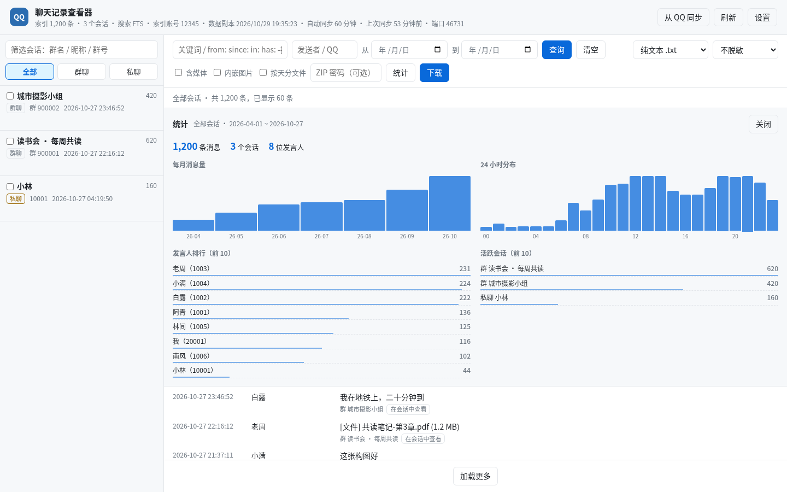
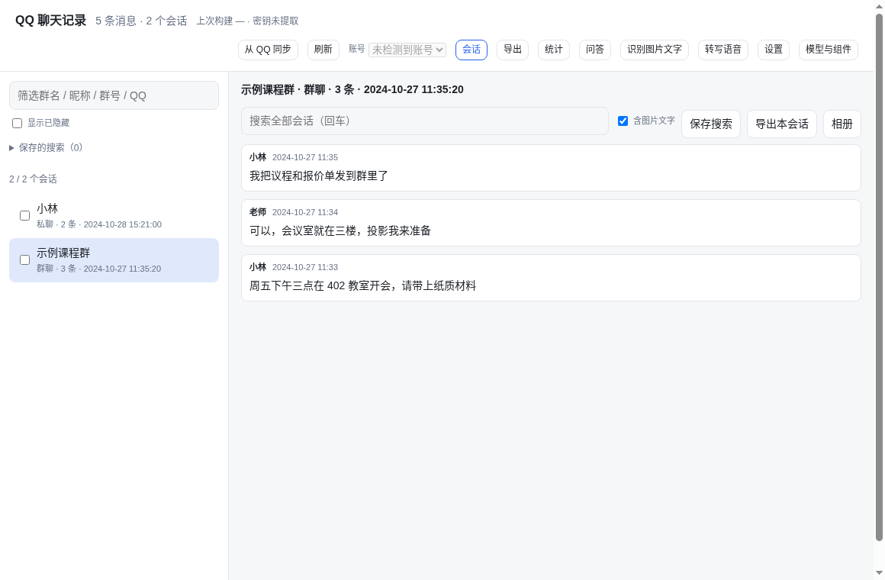

# 功能详情

## 模型工具

在 DSH 会话里直接调用：

| 工具 | 作用 |
|---|---|
| `qqnt_status` | QQ 进程、各账号数据库体积、密钥缓存、Python/SQLCipher/内存读取权限体检 |
| `qqnt_extract_key` | 从**已登录**的 QQ 进程内存里取出数据库密钥并缓存 |
| `qqnt_list_groups` | 群列表：消息数、时间范围、群名 |
| `qqnt_export_group` | 导出单个群为 txt / sqlite / csv |
| `qqnt_list_chats` | 索引里的**全部会话**（群聊 + 私聊）：类型、id、名称、消息数、最后时间 |
| `qqnt_search` | 跨会话关键词搜索（可限定会话、发送者、日期；`senderRegex` 可把发送者当正则），返回会话/发送者/时间 |
| `qqnt_export_chat` | 按 `chatKind` + `chatId` 导出任意会话为 txt / csv / json / md / html / sqlite；可选 `redact`（脱敏）、`media`（含媒体，ZIP）、`split=day`（按天分文件，ZIP）、`embed`（图片内嵌的单文件 HTML）、`preset`（套用网页里保存的导出预设） |
| `qqnt_export_batch` | 一次导出最多 200 个会话到一个 ZIP（每个会话一份文件 + `manifest.json`），支持格式、脱敏、媒体、按天、密码与预设 |
| `qqnt_ask` | 问答检索：给一个问题，返回最可能回答它的对话片段（会话、时间范围、逐条消息与引用编号）；插件不生成句子，答案由宿主模型来写 |
| `qqnt_recall` | 同一套检索的时间线视图：按天分组，用来看一个话题、价格或决定是怎么变的 |

读索引的工具因此能覆盖私聊和跨会话搜索；问答另需派生库里有分块与向量。没有索引时会提示先去网页点「从 QQ 同步」。

## 看图与听语音

聊天记录里大量信息不在正文里：一张截图里的表格、一段语音里的约定。这两类内容先变成文本，再参与搜索与问答。

- **识别图片文字**：网页顶栏点「识别图片文字」，把已下载的截图按批 OCR 成文本，写进派生库的 `content` 表（`source='ocr'`）。重复图片按 md5 只识别一次；小于 8 KB 的缩略图跳过，避免噪声；
- **转写语音**：点「转写语音」，把语音消息解码成 16 kHz 单声道后送本地模型，结果写进同一张表（`source='asr'`）；转写失败的记为跳过，不影响整批；
- **搜索自动带上它们**：网页搜索和 `qqnt_search` 默认同时查正文、识别文字与转写（`sources` 参数可只查 `text`）。命中来自图片或语音时，结果行会标「图片文字 / 语音转写」，悬停可看命中片段；
- **模型文件按需下载**：OCR 模型约 15 MB（安装包自带权重，下载项用于固定版本）、嵌入模型约 24 MB、语音模型约 78 MB。全部在 `workDir/models/<id>/` 下，`lock.json` 记录每个文件的 sha256；
- **可删除**：「模型与组件」视图列出每个模型的大小、状态与用途，删除要点两次（4 秒内确认），删掉后下次要用时重新下载即可，不影响已识别的文本。

识别与转写需要额外的 Python 组件（`rapidocr-onnxruntime`、`av` + `sherpa-onnx`），向量检索还需要 `numpy` / `onnxruntime` / `tokenizers`。在「模型与组件」页的「运行组件」里点一次「安装」就会用插件虚拟环境的 pip 装好，输出进右下角任务日志；当前解释器不是虚拟环境时按钮是灰的，避免装进系统 Python。不想用界面时也可以照 [setup.md](setup.md#可选组件识别--转写--向量) 里的命令手动装。

## 问答与引用

在网页 `?view=ask` 或 `qqnt_ask` 工具里问一句话，返回的是**证据**，不是编好的答案：

- **检索单元是对话片段**：20 条消息一窗、重叠 8 条，中间停顿超过 15 分钟就断开。片段保留 `msg_ids`，所以每条引用都能定位回原消息；
- **两路检索**：一路按问题的词（中文切成二字词）在片段里打分，擅长人名、编号、原话；一路用本地嵌入算语义相似度，擅长换一种说法的提问。两路结果用 RRF（k=60）融合，谁也不能单独霸榜；
- **引用可点回**：网页问答视图里每段下面的引用是按钮，点一下切到「会话」视图，并直接打开这条消息前后的上下文；
- **提示会说实话**：没装嵌入模型、派生库还没向量、没有命中时，返回里会写明原因和下一步（例如「先运行一次分块与嵌入」），而不是假装没有相关内容；
- **分块与嵌入是任务**：问答视图的「分块与嵌入」按钮把工作交给后台任务队列，增量处理：已覆盖的会话跳过，有新消息的会话只重算最后一段窗口；识别/转写补进来新文字时，该会话会整体重算一次，让文字进到已有的窗口里。
- **可选的向量加速**：装了 `usearch` 时，分块任务会顺手写一个 `workDir/vectors.usearch`，检索改走近邻索引；没装就线性扫全部向量（几万段仍是毫秒级）。这个文件只是缓存：删掉、过期或对不上向量表时自动回退线性扫，不会给出过期的命中。

问答的生成放在宿主侧（ADR-008）：插件只负责检索与引用，句子由模型写。这样答案不可能引用检索没找到的内容，插件也不必背一个 LLM 的体积。

## 网页界面

`http://127.0.0.1:46728`

- 左侧列出**全部会话**（群聊 + 私聊），带消息数、最后活动时间，可按群名/昵称/群号/QQ 号筛选；私聊显示好友**昵称（备注）**，没有备注时只显示昵称；
- 关键词、发送者、起止日期组合查询，跨会话搜索，命中处高亮；关键词框还支持 `from:昵称/QQ`、`since:YYYY-MM-DD`、`until:...`、`in:群名/群号`、`has:image/file/voice/video`、`-排除词`；发送者框旁有「正则」开关，默认仍是文本包含，勾选后按 Python `re.search` 语义匹配昵称和 QQ（例如 `^。$` 只命中昵称恰好是「。」的人，不再命中「。。」）；
- **图片预览 / 相册**：消息里的 `[图片]` 直接显示本机缩略图，点击放大；点「相册」按当前会话浏览本机已有的图片墙，可继续加载，点击看大图。预览只读 `nt_data` 内已下载的文件，路径会做 `realpath` 校验；表情、未下载或已清理的媒体不显示，也不会让页面报错；
- 跨会话搜索的每条结果都标出**所在会话**，点「在会话中查看」直接跳到该消息前 20 / 后 19 条上下文并高亮；结果上方还有「群/私聊 名称 · N 条」的命中分布，点一下即可把范围切到该会话；
- **保存搜索**：筛选栏可把当前关键词、发送者（含正则）、日期与会话范围命名保存到浏览器（最多 30 条），左侧「保存的搜索」一键重放，可逐条删除；
- **统计**：点「统计」按当前筛选条件（会话/关键词/日期）显示每月消息量、最近 30 天、24 小时分布、周 × 小时热力图、发言人 Top 10、活跃会话 Top 10，并可**导出 CSV**；全部在本机 SQL 里算，不上传、不调用模型；
- 左侧账号下拉可切换当前索引与缓存账号（复用「切换账号索引」，不重建、不改 QQ 数据）；会话行悬停可**置顶 / 改名 / 隐藏**，保存在 `workDir/chats-state.json`，勾选「显示已隐藏」可恢复，只影响网页显示；
- 关键词框有**搜索历史**（最近 20 条，存在浏览器 localStorage）；自动同步失败会在状态行和 toast 里提示，不会静默停在旧时间；
- 会话列表悬停有「在本会话中搜索」，查询范围以蓝色徽标显示（`×` 回到全部会话）；
- 把**当前查询结果**导出为 `.txt` / `.csv` / `.json` / `.md` / `.html` / `.sqlite`：大导出进入后台任务队列（最多同时 3 个，30 分钟上限），右下角任务面板显示「导出中 / 完成 / 失败 / 已取消」，可随时取消，不再受 180 秒请求超时限制；
- **批量导出**：在会话列表勾选多个群聊/私聊，一次打成 ZIP（每个会话一份文件 + `manifest.json`），最多 200 个会话；
- **脱敏分享**：导出时可选「昵称打码 / QQ 号打码 / 全部」，发送者变成 `成员1…`、会话名变成 `群聊1/私聊1`，QQ 号、群号、私聊 uid、导出账号和 JSON 里的 `chatId` 一并清空；正文保持原样（改动会破坏对话）；
- **含媒体**：可选把本机已下载的图片、文件、语音、视频一起打包（ZIP 布局 `media/<会话>/…`）；缺失的媒体只记录不报错，单文件 100 MB、单次 1 GB 上限；**内嵌图片**把图片 base64 放进单个 HTML，方便直接分享（单会话、10 MB/图、200 MB/次）；
- **按天分文件**：勾选后每个会话按日期拆成多个文件再打包成 ZIP，`manifest.json` 列出每天的文件和条数；可以和脱敏、媒体一起用；
- **导出字段**：CSV 可选列（全部 / 时间+发送者+内容 / 时间+发送者+类型+内容）；Markdown 可选在开头加 YAML 元信息（会话、账号、导出时间），默认关闭；
- **密码 ZIP**：在导出区填一个 4~128 位的密码，导出包会用 AES-256 加密（需要 `pyzipper`，一键安装会装）；密码只经子进程环境变量传递，不会出现在命令行、任务列表或日志里。ZIP 内的文件名不加密，内容加密；打开请用 7-Zip / WinRAR / Bandizip / macOS 归档工具，**Windows 资源管理器自带的解压不支持 AES**；
- **导出预设**：把「格式 + 脱敏 + 媒体 + 按天 + CSV 列 + MD 元信息」存成一个名字（设置页「导出预设」，写在 `workDir/presets.json`），导出区下拉一键套用，模型工具也能用 `preset` 参数引用；预设里只有选项，没有聊天内容；
- **任务面板记得上次**：导出任务列表写在 `workDir/export-tasks.json`（`exports/` 之外，清理导出文件时不会被一起删掉），重启 DSH 后上次的导出仍可下载；导出文件只保留一小时，被清掉的任务显示「文件已清理」而不是死链接；
- 跨会话搜索的命中分布条右侧有「导出这些会话」，一次把命中的会话打成 ZIP（超过 200 个会提示先缩小范围）；
- 「从 QQ 同步」复制最新数据库后**增量追新消息**；消息总数对不上（删除/回溯/换账号）时自动全量重建；
- **启动提示**：网页打开后显示一次启动横幅，告知默认访问地址，并检查 Python / sqlcipher3 / pyzipper / 密钥；缺依赖时可一键创建独立虚拟环境并安装（默认源或清华镜像）；
- **密钥提取**：启动横幅和设置页都有「提取密钥」按钮，网页内显示扫描进度、日志和结果；已配置时可重新提取；点击前后都会提示查找密钥耗时较长（通常 1~3 分钟），请耐心等待；
- **设置**：端口、工作目录 / 索引位置、环境安装方式（自动 / uv / pip）、Python 解释器、QQ 数据根目录、QQ 号、保留账号索引数、搜索索引方式，以及 Python/uv/sqlcipher3/pyzipper 体检；
- **多账号索引缓存**：切换 QQ 账号时把上一个账号的索引留在 `workDir` 里（默认保留 2 个），切回时直接增量更新，不再整库重建；
- **存储与清理**：分类列出插件生成的明文文件及大小（含各账号的缓存索引），二次确认后删除，不碰 QQ 原始数据。

统计面板按当前筛选（会话 / 关键词 / 日期）计算，全部在本机完成：

## 模块化界面（预览）

`http://127.0.0.1:46728/app/` 是重写中的界面：会话列表、消息阅读、问答、模型与组件、后台任务面板
已经可用，导出、统计、设置仍在旧页面 `/`。顶栏的「会话 / 问答 / 模型与组件」切换视图，`?view=ask`
与 `?view=models` 可以直接打开。两套界面共用同一批 `/api/*`，互不影响；在功能对齐之前，`/` 一直是默认入口。

截图使用虚构数据渲染，不含任何真实聊天内容。

## 在 DSH 里用（侧边栏面板）

装进 DSH 后，左侧栏会多一个「QQ 聊天记录」图标（`sidebar.panellist`，排在 Plugins 之后）。点一下，主区
直接显示这个插件的页面——搜索、统计、导出、设置都在，不用再切浏览器标签。

- 面板是一个内嵌的 iframe，地址由宿主路由 `GET /api/qqnt/panel` 提供（同源，只回端口、版本、索引条数、
  上次同步时间这类元数据，不含任何聊天内容）；面板顶部有「刷新」和「在浏览器打开」。
- 端口设成 0（网页服务关闭）或服务没起来时，面板显示中文提示和「刷新」，不会白屏。
- 装了 [`dsh-better-sidebar`](https://github.com/omdsh-dev/DSH-better-sidebar) 时，还会在**右侧栏的「+」列表**里
  多一个「QQ 聊天记录」tab，内容是同一个页面，适合在对话旁边侧看；没装或禁用它时，这个入口自动消失，
  左栏面板不受影响（走的是它的公开服务 `ctx.betterSidebar.registerTab`，不是改它）。
- 切换回「对话」再切回来时，外壳只挂载当前面板，iframe 会重新加载一次——页面自己的状态（关键词、勾选）
  不跨切换保留，这一点比原生重写的面板差，作为已知限制列在下面。

